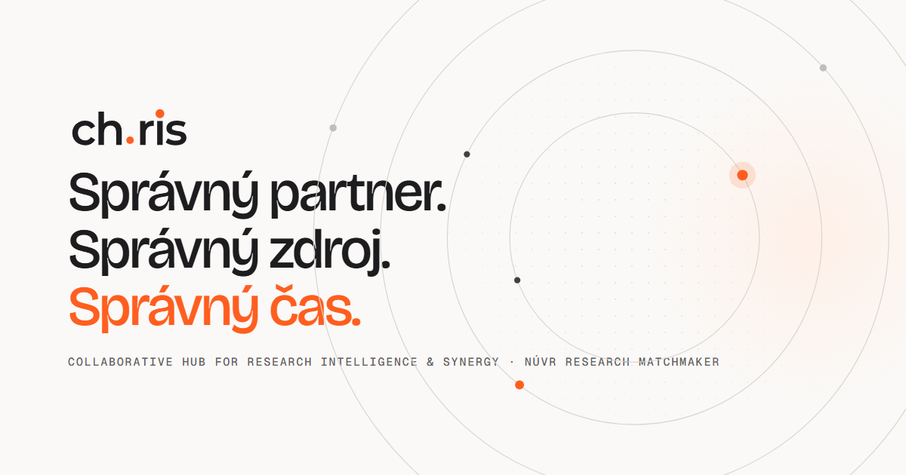
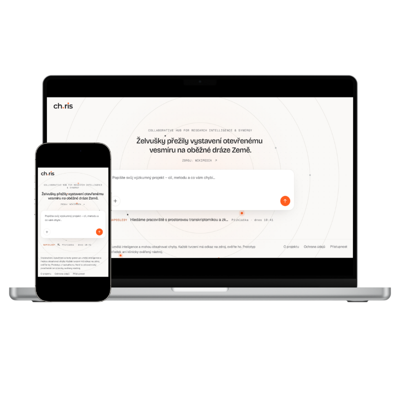
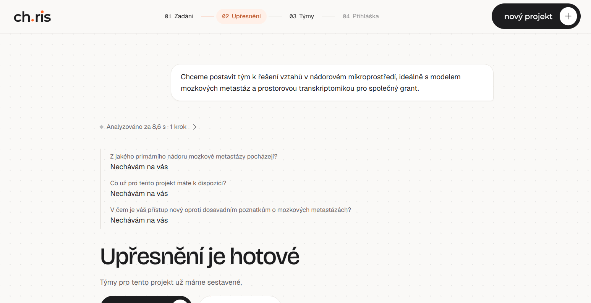
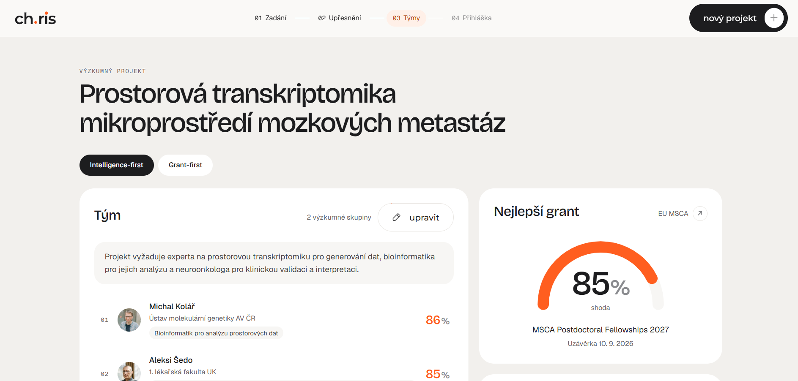

<p align="center">
  
</p>

---

CHRIS pomáhá výzkumníkům sestavit tým pro konkrétní výzkumný projekt. Výzkumník popíše projekt vlastními slovy, systém se doptá na to, co chybí, a navrhne dvě varianty týmu (**INTELLIGENCE**, **GRANT**). U každé skupiny uvede proč, přínos, mezeru a první krok a každé tvrzení podloží dohledatelným zdrojem.

## Ukázky

<p align="center">
  
  <br>
  <sub><b>Zadání</b> · výzkumník popíše projekt vlastními slovy, na desktopu i mobilu</sub>
</p>

<table align="center">
  <tr>
    <td align="center" width="50%">
      
      <br>
      <sub><b>Upřesnění</b> · AI se doptá na to, co chybí</sub>
    </td>
    <td align="center" width="50%">
      
      <br>
      <sub><b>Týmy</b> · navržený tým, shoda skupin a nejlepší grant</sub>
    </td>
  </tr>
</table>


## Stack

React 19 · Vite · TypeScript · Tailwind CSS v4 · Motion · TanStack Router a Query · Zustand · React Hook Form · Zod

Repozitář obsahuje jen frontend. Backend je samostatný; typy API se generují z jeho OpenAPI (`pnpm gen:api`), ručně se nepíšou.

## Spuštění

Potřebujete Node.js 22 a pnpm 10. Bez backendu aplikace běží v **demo režimu** nad ilustračními daty (v UI je to vyznačené).

```bash
pnpm install
pnpm dev               # http://localhost:5173 (demo režim)
```

S backendem: do `.env` nastavte `VITE_API_URL` (adresa backendu) a `VITE_DEMO=false`.

| Příkaz | Co dělá |
|---|---|
| `pnpm gen:api` | vygeneruje typy z běžícího backendu |
| `pnpm typecheck` · `pnpm lint` | kontrola typů a lint |
| `pnpm build` | produkční build (vyžaduje `VITE_API_URL` s `https://`) |
| `pnpm test:e2e` | E2E testy (Playwright): celý flow, hraniční stavy, přístupnost (axe), bezpečnost; Chromium, Firefox, WebKit a mobil s omezeným pohybem |
| `pnpm audit --prod` | kontrola zranitelností závislostí |

Poprvé před testy: `pnpm exec playwright install`.

## Struktura

```
docs/
  cover-16x9.png
  mockups/
    01-mockup.png
    02-upresneni.png
    03-tymy.png
public/
  images/
    og.png
    favicon.svg
```

## Před nasazením

- [ ] `src/lib/site.ts`: kontaktní e-mail správce (`contactEmail`) a finální URL
- [ ] `public/.well-known/security.txt`: skutečný kontakt
- [ ] `public/robots.txt` a `<meta name="robots">`: povolit indexaci, až bude veřejné
- [ ] `VITE_API_URL` (https) a `VITE_DEMO=false` v buildu
- [ ] `pnpm test:e2e` a `pnpm audit --prod` bez chyb

## Bezpečnost

- Prohlížeč komunikuje jen s naším backendem; žádné klíče ani externí API ve frontendu. Vše s prefixem `VITE_` je veřejné.
- Build generuje bezpečnostní hlavičky (CSP, HSTS, `nosniff`, ochrana proti vložení do iframe).
- Texty z API se vykreslují jako text, nikdy jako HTML.
- Jen veřejná data, žádná data pacientů. Výstupy jsou koncepty, oficiální podání probíhá v ISVP/GRIS.
- Žádné cookies ani analytika. Právní stránky: `/o-projektu`, `/ochrana-udaju` (GDPR), `/pristupnost` (WCAG 2.1 AA); upozornění na AI v patičce.
- E2E testy hlídají, že prohlížeč volá jen vlastní origin a Google Fonts, že build nese CSP a že v kódu není `eval` ani vkládání HTML.

## Licence

Tento projekt je dostupný pod licencí [MIT](LICENSE).

<sub>Není to zdravotnický prostředek ani klinicky ověřený nástroj.</sub>